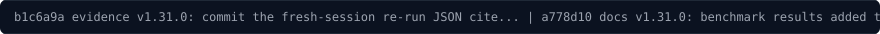
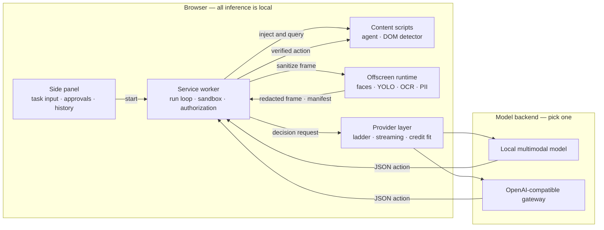
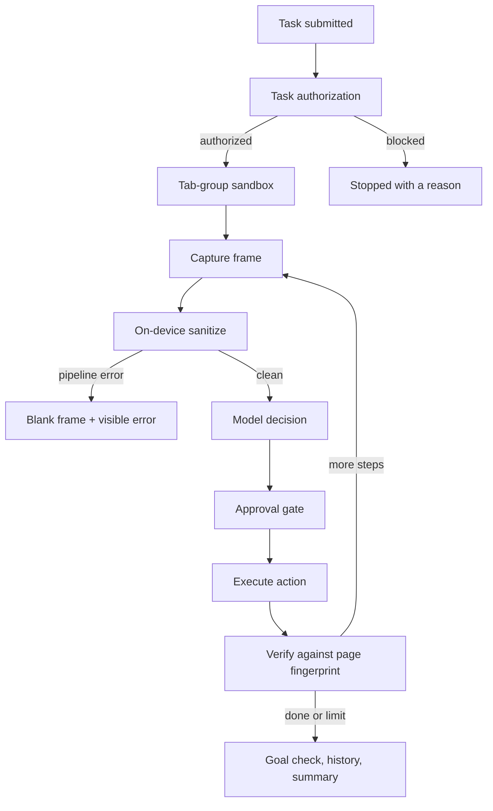

<div align="center">


# OpenComet-SIH

**A browser agent that removes sensitive content from the screen before any model sees it.**

[](docs/changelog/INDEX.md)
[](https://github.com/princechouhan19/OpenCometAI/actions/workflows/ci.yml)
[](LICENSE)
[](manifest.json)
[](test)
[](#how-the-privacy-contract-works)

Smart India Hackathon 2026 · Problem Statement #26171 · On-device visual perception for light-weight browser agents

</div>



---

OpenComet-SIH is a Chrome extension that drives a browser from a task description
and never transmits the raw screen. Faces, credential fields, and text PII are
detected and redacted locally, in the offscreen document, before a single byte
leaves the device. The model receives a sanitised screenshot, sanitised DOM text,
and a manifest describing what was hidden and why.

It runs with three interchangeable backends: a local multimodal model, any
OpenAI-compatible gateway with your own key, or a companion Ollama server. The
model choice does not change the privacy contract, because the redaction happens
before the request is built.

- **Latest release:** 1.32.0 · [changelog](docs/changelog/INDEX.md) · [release notes](docs/changelog/v1.32.0.md)
- **Requirements:** Chrome 116+ (WebGPU recommended), Node 20+ for development
- **License:** MIT · **Status:** hackathon submission, actively developed

## Contents

- [Features](#features)
- [Quick start](#quick-start)
- [How it works](#how-it-works)
- [How the privacy contract works](#how-the-privacy-contract-works)
- [Reliability](#reliability)
- [Benchmarks](#benchmarks)
- [Development](#development)
- [Project structure](#project-structure)
- [Documentation](#documentation)
- [Roadmap](#roadmap)
- [Known limitations](#known-limitations)
- [Contributing](#contributing)
- [Credits](#credits)

## Features

**Privacy**

- Fail-closed boundary. Every network-bound screen context passes a single gate
  (`src/lib/privacy-firewall.js`). If the pipeline throws, a blank 1×1 frame is
  sent; raw pixels are never the fallback.
- Four detection layers: MediaPipe face detection (tiled sweep plus DOM-guided
  rescue for small avatars), DOM semantic scan of credential fields, regex plus
  checksum validation (Luhn, Verhoeff, mod-97), and optional BERT NER.
- Indian identity formats: Aadhaar and VID, PAN, Voter ID, passport, driving
  licence, IFSC, UPI VPA, GSTIN, bank accounts. Context-gated so prose does not
  match.
- Byte-level wire guard. The serialised payload is re-scanned for known values
  and secret shapes after redaction, before transmission.
- No telemetry. Nothing is sent anywhere unless you configure a provider.

**Agent**

- Goal contracts. The model declares what "done" looks like as a predicate over
  page state, and the run is verified against the live DOM before it can close.
- Verified actions. Every click is checked against a page fingerprint (URL,
  title, scroll, dialogs, focus, content signature).
- Task authorization. Purchase and deletion clicks require authorization from
  your own task text, not from page content.
- Tab-group sandbox. The agent can only act inside the tab group it created.
- Approval mode. Optional gate on every action, with per-session host approval.

## Quick start

**1. Load the extension.** Open `chrome://extensions`, enable Developer mode,
choose **Load unpacked**, and select this folder. Pin the icon and open the side
panel.

**2. Choose a backend.**

```bash
# On-device, no server (recommended)
# Side panel -> Settings -> AI & Models -> Local -> download a model

# Cloud provider with your own key
# Side panel -> Settings -> Provider -> paste key (OpenAI, Anthropic, Gemini, OpenRouter)

# Companion server, fully offline
cd server && OLLAMA_BASE_URL=http://localhost:11434 npm start
```

**3. See redaction without a task.** Open [`docs/assets/demo-page.html`](docs/assets/demo-page.html),
click **Test capture + redact**, and compare the capture with the sanitised
output.

**4. Run a task.** Privacy mode is on by default. Try
*"Find the cheapest flight from Bengaluru to Delhi next Friday."*

## How it works



Each pass through the loop is sanitised, authorized, and verified:



## How the privacy contract works

| Layer | Implementation | Catches | Cost |
|---|---|---|---:|
| Pixel | MediaPipe FaceDetector, tiled and DOM-crop sweeps | faces, blurred with an eye bar | 15–40 ms |
| Pixel | Canvas redactor | password, card, OTP fields, solid black | 3–8 ms |
| Text | Regex, checksums, optional BERT NER | emails, phones, Aadhaar, PAN, IBAN, API keys | 2–5 ms |
| Pixel | Canvas pixelate | free-form PII text | 3–8 ms |

Every redacted region is described in a JSON manifest sent alongside the image,
so the model knows what it cannot see. DOM text is tokenised
(`[REDACTED:email]`) before transmission.

Deep dive: [`docs/architecture/PRIVACY_VISION.md`](docs/architecture/PRIVACY_VISION.md).

## Reliability

Agent failures are usually belief failures: the model thinks an action worked
when it did not. Three mechanisms address that.

- **Goal contracts** (`src/lib/goal-verifier.js`). The planner declares
  `goal_checks` over observable page state (`url_matches`, `text_contains`,
  `element_exists`, counts). Before a run may close, the checks are evaluated
  against the live page. A failed check returns the observation to the agent and
  the loop continues. A run that never declares a contract closes as
  `completed_unverified`, never as verified.
- **Error classification** (`src/lib/error-taxonomy.js`). Transport faults are
  retried with exponential backoff and a server-supplied `Retry-After` is
  honoured exactly; auth and policy failures are terminal on the first attempt;
  a stale DOM re-probes immediately. A provider 502 is no longer counted as a
  task failure.
- **Loop reflection** (`src/lib/loop-reflection.js`). Repeated actions,
  oscillation, and dead waits are detected over the action history and produce a
  strategy-change prompt, capped at three per run.

## Benchmarks

All numbers below come from committed result JSON. The benchmark is in
[`OpenCometBench/`](OpenCometBench/README.md); methodology is documented there.

```bash
node OpenCometBench/run-all.js                     # six offline suites, exit 0 = targets met
node OpenCometBench/run-opencomet-bench.mjs --all  # adds browser and adversarial tiers
node OpenCometBench/regression-gate.mjs --current <run.json>   # compare against baseline
```

| Metric | Measured | Source |
|---|---|---|
| PII precision / recall | 1.00 / 1.00 on a 366-case synthetic corpus built from the detector's own rules | `privacy.bench.js` |
| Redaction coverage / mean IoU | 1.000 / 0.987, 0 pixel leakage in 340, 0% over-redaction (browser tier) | `browser/harness.mjs` |
| Visual context accuracy | 12/12 DOM-fused, 12/12 ViT-fused (browser tier) | `browser/harness.mjs` |
| Security, fuzz, server validation | 29/29, 0 leaks in 216, 25/25 | three suites |
| Sanitize p50, warm unchanged screen | 1216 ms (memo hit) | browser report |
| Changed frame, full re-detect | 12885 ms (YOLO 7841 + OCR 3402) | browser report |
| Real-VLM step | 4679 ms model, 777 ms action, 0 privacy blocks | `e2e-real` |

Conditions are never merged: cold start, warm unchanged screen, and changed
frame are three different measurements. The synthetic PII corpus is
self-consistent rather than externally validated; building an independent corpus
is on the roadmap.

**Note on version.** These figures were measured at 1.31.0. The perception
pipeline is unchanged in 1.32.0.

## Development

The extension has no runtime dependencies. There is nothing to install.

```bash
npm test                 # 55 unit tests, node:test
npm run check            # unit tests plus the six benchmark suites
npm run package          # gates, then dist/opencomet-<version>.zip
bash scripts/check-style.sh   # comment-style gate
```

The packaging script refuses to build when the manifest and package versions
disagree, when a placeholder or credential-shaped string is present, when the
style gate fails, or when any test or benchmark fails.

Development-time browser harnesses live in `scripts/` and run without
Playwright:

```bash
node scripts/test_v1180_guardian.mjs
node scripts/test_v1190_disambiguation.mjs
node scripts/test_v1300_latency_roi.mjs
node scripts/test_v1310_verify.mjs
node scripts/test_scene_change_attack.mjs
node scripts/test_tab_sandbox.mjs
node scripts/test_creditfit_402.mjs
```

Continuous integration runs the tests on Node 20 and 22, the benchmark suites,
the style gate, the no-browser harnesses, and a full package build
([`.github/workflows/ci.yml`](.github/workflows/ci.yml)). A tag matching the
manifest version builds and attaches the release zip
([`.github/workflows/release.yml`](.github/workflows/release.yml)).

## Project structure

```
src/
  background/     service worker, agent loop, action execution, privacy loop
  content/        DOM detection and page instrumentation
  lib/            providers, prompts, privacy pipeline, PII detection, goal contracts
  offscreen/      ML runtime: MediaPipe, ONNX, OCR
  sidepanel/      UI
  core/           logging and shared utilities
OpenCometBench/   six offline suites, browser and adversarial tiers, dashboard
docs/             architecture, guides, changelog, roadmap, research
scripts/          packaging, style gate, regression harnesses
server/           optional companion server
test/             node:test suites
```

## Documentation

| Document | Contents |
|---|---|
| [`docs/README.md`](docs/README.md) | Index of all documentation |
| [`docs/architecture/PRIVACY_VISION.md`](docs/architecture/PRIVACY_VISION.md) | How redaction works, stage by stage |
| [`docs/architecture/FILE_GUIDE.md`](docs/architecture/FILE_GUIDE.md) | What each source file does |
| [`docs/guides/GETTING_STARTED.md`](docs/guides/GETTING_STARTED.md) | Installation and first task |
| [`docs/guides/FEATURES_GUIDE.md`](docs/guides/FEATURES_GUIDE.md) | Feature reference |
| [`docs/guides/DEVELOPER_GUIDE.md`](docs/guides/DEVELOPER_GUIDE.md) | Architecture and conventions |
| [`docs/guides/DIAGNOSTICS_LOGGING.md`](docs/guides/DIAGNOSTICS_LOGGING.md) | Reading the logs |
| [`docs/changelog/INDEX.md`](docs/changelog/INDEX.md) | Release notes, one file per version |
| [`docs/ROADMAP.md`](docs/ROADMAP.md) | Engineering roadmap, measurement-first |
| [`OpenCometBench/README.md`](OpenCometBench/README.md) | Benchmark methodology |

## Roadmap

Priorities, in order:

1. Make goal contracts universal: the planner should always emit one, with a
   single re-ask before accepting an unverified close.
2. Perception latency. Detection dominates a changed frame at 12.9 s. Candidate
   work: detector input resolution, per-model backend selection, OCR
   detect-then-recognise, batching, phase parallelism, prewarming.
3. An independent PII corpus, so precision and recall are externally validated
   rather than self-consistent.
4. Move the `debugger` permission to optional, with a documented degraded path.
5. Extract the loop's decision core from `sw.js` so the agent loop is testable
   without a browser.

Details, including what would count as evidence for each item:
[`docs/ROADMAP.md`](docs/ROADMAP.md).

## Known limitations

- Firefox has no WebGPU on stable, so the pipeline falls back to WASM. It works,
  it is slower.
- Cross-origin iframe DOM text cannot be scanned. Faces inside them are still
  blurred at the pixel level.
- Full re-detection on a materially changed screen is deliberate; the cost buys
  the guarantee that a changed screen is never served from a cache.
- BERT NER is opt-in at roughly 110 MB; the regex pass covers most tasks.
- The extension has not been published to the Chrome Web Store; load it unpacked.

## Contributing

Read [`CONTRIBUTING.md`](CONTRIBUTING.md) first. Run `npm run check` before
opening a pull request. Behaviour changes need a test that fails without the
change. The project follows [`CODE_OF_CONDUCT.md`](CODE_OF_CONDUCT.md).

## Credits

Built on the OpenCometAI codebase. Libraries: Transformers.js (Apache-2.0),
MediaPipe Tasks-Vision (Apache-2.0), ONNX Runtime Web (MIT), Tesseract.js
(Apache-2.0). Model weights are used under their own model cards; see
[`LEGAL.md`](LEGAL.md). Code is MIT licensed; see [`LICENSE`](LICENSE).

## Star history

[](https://star-history.com/#princechouhan19/OpenCometAI&Date)

<div align="center"><sub><a href="#opencomet-sih">Back to top</a></sub></div>
