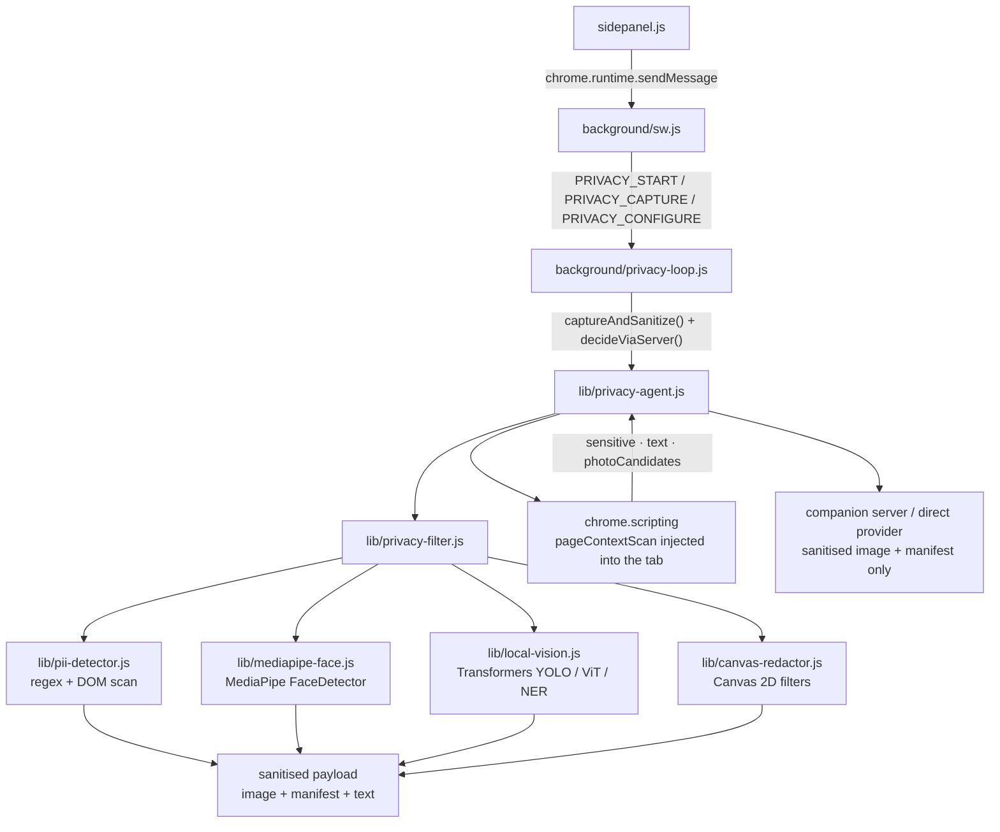
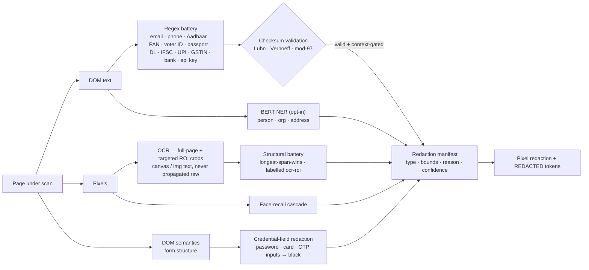
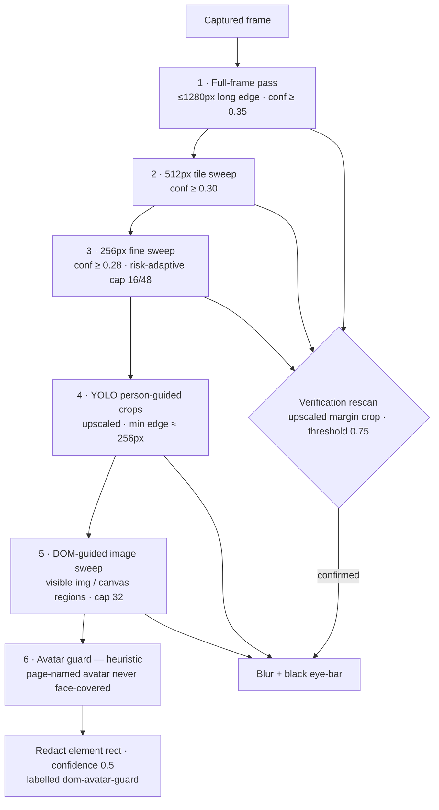

# Privacy pipeline architecture

How the privacy-preserving vision pipeline is built. Written for developers who
need to extend, debug or replace parts of it.

## Module graph



### What catches what



Indian identity families (Aadhaar and VID, PAN including mid-entry, Voter ID or
EPIC, passport, driving licence, GSTIN, bank account, IFSC, UPI VPA) are
pattern and context gated. A Luhn-valid card wins arbitration over an
Aadhaar-shaped match, so hyphenated card numbers cannot fire twice.

## The client-server contract

The client sends a multipart form to `POST /agent/decide`:

| Field | Type | Description |
|---|---|---|
| `image` | file | JPEG or PNG screenshot, already redacted. At most about 500 KB after redaction |
| `sanitizedText` | string | DOM text with `[REDACTED:<type>]` tokens in place of PII. At most 12 KB |
| `manifest` | JSON string | Array of redacted regions: `{type, bounds, selector?, label?, reason, confidence}` |
| `task` | string | The user's goal |
| `history` | JSON string | Last six `{action, result}` entries |
| `settings` | JSON string | `{provider, model, apiKey, providerBaseUrl, ollamaBaseUrl}` |

The server responds with:

```json
{
  "ok": true,
  "backend": "ollama",
  "latencyMs": 820,
  "rawResponse": "<model's raw text>",
  "actionPlan": {
    "thought": "I see a search box at the top of the page",
    "action": { "type": "type", "selector": "input[name='q']", "text": "ISRO" },
    "confidence": 0.9,
    "is_complete": false
  },
  "manifestSummary": { "regions": 3, "byType": { "password": 1, "face": 1, "email": 1 } }
}
```

## Treatment by type

Each PII type gets a different pixel treatment, because the result also tells
the model something about what was underneath.

| Type | Treatment | Reason |
|---|---|---|
| `face` | Blur and a black bar across the eyes | Keeps "a person is here" while destroying identity |
| `password` | Solid black | Unambiguous credential signal |
| `credit_card` | Solid black | Same |
| `aadhaar`, `pan` | Solid black | Same |
| `voter_id`, `passport`, `driving_license`, `gstin`, `bank_account`, `ifsc`, `upi` | Solid black | The Indian ID family from v1.15.2. Context-gated formats such as partial PAN, passport and DL fire only when their label is within ±40 characters |
| `api_key` | Solid black | Same |
| `email`, `phone` | Pixelated in large blocks | Keeps "contact information is here" without the value |
| `person`, `org` | Pixelated | Same |
| `address` | Pixelated | Same |
| `dob`, `ip` | Pixelated | Same |

**Pixel-only sources (OCR, v1.15.4).** Text baked into canvases and images is
covered by two OCR passes. The first is a full-page recognition with a word
confidence threshold of 60, including the v1.14 low-confidence line rescue at
×2.5. The second is a targeted crop pass: the DOM hands over every visible
`<canvas>` at 60 px or larger (`pixelTextRects`, sorted by area, capped at 12)
plus larger `` candidates, and each region is re-read as an isolated
×2 upscaled crop, where Tesseract segments one small document instead of a
noisy page.

ROI text runs through the shared PII detector in both space-joined and
line-fused forms, and through a structural battery mirroring the DOM text rules:
email, Aadhaar-shaped 4-4-4, PAN, API key, 13 to 19 digit cards, and plausible
phones of 10 digits or more, with longest span winning. Findings map back
through the crop's own word spans, and raw OCR text never propagates. Battery
hits are structural, bounded to 12 crops, and labelled `ocr-roi` or
`ocr-roi-battery` in the manifest.

## Coordinate spaces

The common bug in canvas redaction is mixing CSS pixels from
`getBoundingClientRect()` with device pixels from
`chrome.tabs.captureVisibleTab()`. The content script passes
`scaleX = scaleY = window.devicePixelRatio` to the redactor, which multiplies
every box coordinate before drawing.

```js
// privacy-agent.js
const dprInfo = await chrome.scripting.executeScript({
  target: { tabId },
  func: () => ({ dpr: window.devicePixelRatio || 1, ... }),
});
// ...
const result = await runPrivacyPipeline(
  { imageDataUrl, domText: text, domSensitive: sensitive },
  { ...opts, scaleX: dpr, scaleY: dpr }
);
```

## Failure modes

| Failure | Mitigation |
|---|---|
| No WebGPU | `local-vision.js` falls back to WASM SIMD |
| Transformers.js fails to load | YOLO, ViT and NER are opt-in; face detection, DOM scan and regex still run |
| MediaPipe fails to load | `privacy-filter.js` catches it and continues without face redaction, logging a warning |
| Canvas redaction throws | `privacy-filter.js` returns a 1×1 blank PNG; the raw screenshot is never sent |
| Server unreachable | `decideViaServer()` throws and the loop surfaces the error |
| Server returns non-JSON | `parseActionPlan()` returns `{action: {type: 'ask_user'}, parseError: true}` |
| The model tries to guess a redacted value | The system prompt forbids it: *"NEVER try to fill in or guess redacted values. Treat them as opaque."* |

### Face-recall cascade

Face detection runs in recall order in `privacy-filter.js`. Every stage except
the last must be model-confirmed before a pixel is blurred. The final avatar
guard trades a little precision to close a leak reported three times from the
field.

1. **Full-frame pass.** Downscaled to a 1280 px long edge, confidence 0.35 and
   above. Catches large faces.
2. **512 px tile sweep.** Confidence 0.30 and above. Catches medium and small
   faces on large captures.
3. **256 px fine sweep.** Confidence 0.28 and above, with a risk-adaptive cap of
   16 or 48 tiles. Catches avatars and webcam-overlay faces.
4. **YOLO person-guided crops.** When YOLO boxes a person but no face fires,
   each person crop is upscaled to a 256 px minimum edge, capped at ×4, and
   rescanned.
5. **DOM-guided image sweep (v1.15.3).** This stage fixed the reported gap where
   small profile photos stayed visible. `pageContextScan` collects the rects of
   every visible `` at 24 px or larger that is on screen and decoded, with
   avatar-likeness as a sort key rather than a gate, capped at 32 regions. Every
   region not already covered by a detected face is cropped, upscaled and
   rescanned by the same detector (`source: mediapipe-dom-crop`, confidence
   0.30, about 5 to 85 ms per region). It is deterministic: no tile sampling
   lottery and no dependence on YOLO person boxes. Only model-confirmed faces
   are redacted, so logos, icons and illustrations are left alone.
6. **Avatar guard (v1.15.4), heuristic.** The second field round showed the
   model-gated sweep still leaking in two cases: avatars painted as CSS
   `background-image`, which the collector now includes as
   `hint: bg-avatar-hint`, and portraits the detector refuses at every scale. An
   image the page itself names as an avatar or profile photo (`avatar-hint` or
   `bg-avatar-hint`, minimum edge 24 to 180 CSS px) that no confirmed face
   covers is redacted on its element rect with `source: dom-avatar-guard` and
   confidence 0.5. The stand-down test is a confirmed face box centred inside
   the rect, or at least 25% intersection, because measured face-box coverage
   across portraits spans 33% to 52% and ratio-only thresholds mis-fire. A
   wrongly guarded hinted image costs a black square; a missed face ships
   identity. Un-hinted icons and logos are still scanned and never
   blanket-redacted.

Stages 1 to 3 send candidates through a verification rescan on an upscaled
margin crop with a 0.75 threshold, so page textures cannot hallucinate into face
blurs. Stages 4 and 5 produce their hits by that same crop protocol. Stage 6 is
heuristic by design and labelled as such in telemetry (`stats.avatarGuard`) and
in the console (`Faces(avatar-guard): …`).



## Performance budget

Measured on a 2023 MacBook Pro M2, Chrome 120, 1280×800 viewport:

| Phase | Time (ms) | Notes |
|---|---:|---|
| `chrome.tabs.captureVisibleTab` | 15 | PNG encode on the service worker |
| DOM scan (content script) | 3 | Synchronous, about 4000 text nodes |
| MediaPipe face detect (WebGPU) | 24 | About 600 ms init on first call, then cached |
| YOLO object detect (opt-in) | 62 | About 1.5 s init on first call, then cached |
| Regex PII scan | 2 | Trivial |
| BERT NER (opt-in) | 180 | About 3 s init on first call, then cached |
| Canvas redaction | 8 | Typically 5 to 20 regions |
| **Client pipeline** | **~50** | Without YOLO and NER |
| Network upload (sanitized PNG) | 40 | About 80 KB |
| Server-side model (Ollama llava) | 720 | Local |
| **End to end per step** | **~810** | |

A non-private pipeline uploading a raw screenshot and raw DOM to a cloud model
typically takes about 1200 ms end to end. The privacy pipeline adds under 100 ms
on the client and saves time on upload, because the payload is smaller.

## CSP and permissions

`manifest.json` declares:

```json
"content_security_policy": {
  "extension_pages": "script-src 'self' 'wasm-unsafe-eval' 'unsafe-inline'; object-src 'self'; connect-src 'self' https: http://127.0.0.1:* http://localhost:* data: blob:; img-src 'self' data: blob: https:; worker-src 'self' blob:;"
}
```

- `'wasm-unsafe-eval'` is required by ONNX Runtime Web, Transformers.js and the
  MediaPipe WASM builds.
- `'unsafe-inline'` is needed because Transformers.js and MediaPipe inject
  inline styles.
- `connect-src https:` allows model downloads from `huggingface.co` and
  `storage.googleapis.com`.
- `connect-src http://127.0.0.1:*` allows a local Ollama or companion server.
- `worker-src 'self' blob:` allows the blob workers Transformers.js spawns for
  WebGPU.

`host_permissions` includes the three CDN domains, so the first model load does
not trigger a permission prompt.

## Extending the pipeline

### Add a PII pattern

Edit `src/lib/pii-detector.js`:

```js
const REGEX_PATTERNS = [
  // ...existing patterns...
  {
    type: 'my_custom_type',
    re: /MY_PATTERN/g,
    confidence: 0.85,
  },
];
```

Add a case to `maskForType()` and to the switch in `canvas-redactor.js` if the
type needs its own pixel treatment.

### Add a local model

Edit `src/lib/local-vision.js`:

```js
const MODEL_ID = {
  // ...
  myModel: 'Xenova/my-model',
};

export async function getMyPipeline() {
  if (_pipelines.myModel) return _pipelines.myModel;
  const tr = await loadTransformers();
  _pipelines.myModel = await tr.SomeTask.fromPretrained(MODEL_ID.myModel, {
    quantized: true,
    device: _stats.backend === 'webgpu' ? 'gpu' : 'cpu',
  });
  return _pipelines.myModel;
}
```

### Add a server backend

Edit `server/server.js`:

1. Add the backend name to `detectBackend()`.
2. Add a `defaultModelFor()` case.
3. Add a `callXxx()` function, using `callOllama()` or
   `callOpenAICompatible()` as templates.
4. Add a case to the switch in `callModel()`.

The extension needs no changes; the backend is selected server side from the
`settings` JSON it sends.
