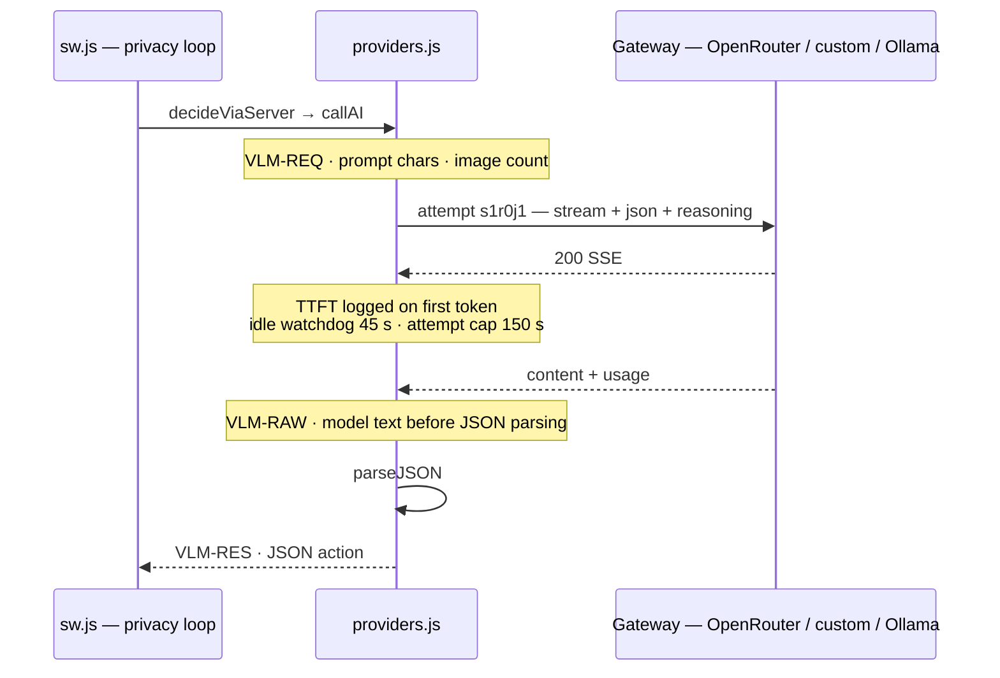
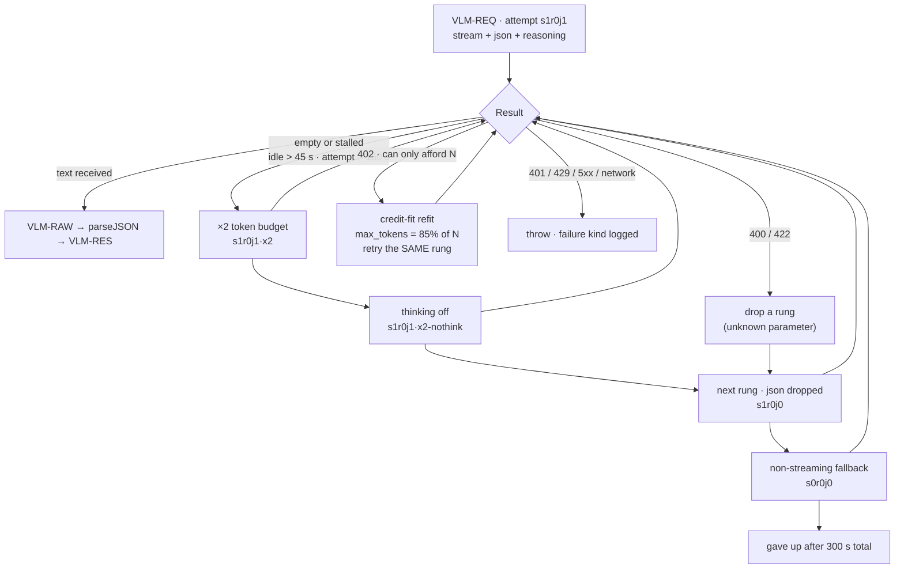

# Diagnostics and console logging (v1.29.0)

Every stage of a run writes tagged, timestamped console lines: planner calls,
model requests, privacy gating, action verification and failures. This guide
shows each channel, walks through a captured run, and explains how to collect
logs for a bug report.

The logs never print pixels or unredacted personal data. Images are summarized
(name, type, size), and page text is logged only after the privacy pipeline has
sanitized it.

## Where the logs are

Open Comet logs to three consoles.

| Console | How to open | What appears |
|---|---|---|
| Service worker | `chrome://extensions`, OpenComet, **Inspect views: service worker** | Run lifecycle, model calls, privacy loop, errors |
| Side panel | Right-click the panel, **Inspect** | UI messages plus warn and error lines relayed from the worker (`DIAG_LOG`) |
| Offscreen ML runtime | `chrome://extensions`, inspect the offscreen view while a model runs | Model load, backend selection, warm-up, on-device inference |

Keep the service worker console open while debugging. Warn and error lines from
the worker are also relayed to the side panel console, so a problem is visible
with only the panel open.

## Anatomy of a log line

The unified logger (`src/core/logger.js`) prints:

```
[HH:MM:SS.mmm][Open Comet:NAMESPACE][LEVEL] message
```

For example:

```
[18:17:21.534][Open Comet:Agent][WARN] iteration 1 failed (consecutive=1): No input matched: uid:nx-2 — on page: fields: Search (input)
```

| Part | Meaning |
|---|---|
| `HH:MM:SS.mmm` | Local time, millisecond precision |
| `Open Comet:NAMESPACE` | Subsystem that produced the line |
| `LEVEL` | `DEBUG`, `INFO`, `WARN` or `ERROR`, colour-coded |

Namespaces:

| Namespace | Covers |
|---|---|
| `API` | Every model request: start, latency, TTFT, failures |
| `Agent` | Loop decisions, iteration failures, verdicts |
| `Busy` | Run-lock contention |
| `Limits` | Step and token budget accounting |
| `Router` | Message routing between panel, worker and content scripts |
| `SW` | Service worker lifecycle |
| `Sidepanel` | UI-side messages |
| `Offscreen` | ML runtime document lifecycle |
| `LocalML` | On-device model status and relay lines |

Three collapsed console groups carry full model request and response payloads,
described below. Two prefixes mark other channels: `[LocalML]` for runtime
relay and `[SIH]` for privacy-mode decisions.

The last 500 tagged lines are kept in an in-memory ring buffer for diagnostics
dumps (`getRecentLogs()`).

## A captured run, line by line

The run below is a real capture (task: search a song on a music site), trimmed
to one line per event. Stack frames added by DevTools are omitted.

```
[LocalML] [OpenComet] vdev · offscreen ML runtime
[LocalML] Offscreen ML runtime booted · backend=webgpu · webgpu=true
[LocalML] webnn: N/A: navigator.ml is undefined — this browser does not expose WebNN
[OffscreenBridge] offscreen document created
```

The runtime document is up and WebGPU is available. WebNN is absent, which is
informational: the runtime uses WebGPU.

```
[Open Comet] Planner role: analyzing task and building plan…
[Open Comet] Planning screenshot  (+2.2s)
[Open Comet] Planner role: calling custom...  (+0.0s)
[SIH] SIH MODE: raw screenshot blocked from network transmission (agent continues with sanitized/DOM context only).
```

The planner starts. In SIH mode the raw screenshot is never put on the wire; the
planner works from the sanitized DOM context.

```
[18:16:55.542][Open Comet:API][INFO] → custom/qwen/qwen3-vl-235b-a22b-thinking · prompt=8161c
[Open Comet][VLM-REQ] → custom/qwen/qwen3-vl-235b-a22b-thinking · prompt 8161 chars · 0 image(s)
[18:17:09.306][Open Comet:API][INFO] ⚡ OpenAI Compatible/qwen/qwen3-vl-235b-a22b-thinking · TTFT 12120ms [s1r0j1] — prefill+reasoning done, generating…
[18:17:11.037][Open Comet:API][INFO] ✓ OpenAI Compatible/qwen/qwen3-vl-235b-a22b-thinking · total 13852ms · TTFT 12120ms · gen 1732ms · 435 chars (~251 c/s) · out=865tok
[Open Comet][VLM-RAW] ← OpenAI Compatible/qwen/qwen3-vl-235b-a22b-thinking · 435 chars (model text before JSON parsing)
[18:17:11.039][Open Comet:API][INFO] ✓ custom/qwen/qwen3-vl-235b-a22b-thinking · 15497ms
[Open Comet][VLM-RES] ← custom/qwen/qwen3-vl-235b-a22b-thinking · 15497ms
```

One complete model turn: 15.5 s end to end, of which 12.1 s was time to first
token, followed by 435 characters at about 251 characters per second.

```
[Open Comet] Plan ready  (+15.5s)
[Open Comet] Starting execution…
[Open Comet] Screenshot #1  (+0.5s)
[Open Comet] Navigator role: deciding next action… (step 1)
[18:17:11.572][Open Comet:API][INFO] → custom/qwen/… · prompt=62191c
[18:17:21.425][Open Comet:API][INFO] ✓ OpenAI Compatible/… · total 6177ms · TTFT 4954ms · gen 1223ms · 217 chars (~177 c/s) · out=358tok
```

Execution begins. The navigator prompt is much larger, 62k characters, because
it carries the page manifest and task history.

```
[Open Comet] Verifier role: fresh DOM check passed for type (uid:nx-2)
[Open Comet] Type "Shape of You Ed Sheeran" into uid:nx-2
[Open Comet] No input matched: uid:nx-2 — on page: fields: Search (input)
[18:17:21.534][Open Comet:Agent][WARN] iteration 1 failed (consecutive=1): No input matched: uid:nx-2 — on page: fields: Search (input)
[18:17:21.535][Open Comet:Agent][ERROR] fatal: No input matched: uid:nx-2 — on page: fields: Search (input)
[Open Comet] No input matched: uid:nx-2 — on page: fields: Search (input)
```

The verifier re-checked the DOM and the type action ran, but the target input
was not on the page; the manifest's only field was `Search`. The loop reports
the iteration failure, escalates according to its policy, and the run ends with
that explanation in History. The run does not claim success.

## The model request lifecycle

Every model call, on any provider, logs through `src/lib/providers.js`.

| Line or group | Shows |
|---|---|
| `→ provider/model · prompt=Nc · image` | Request start and prompt size in characters |
| `[VLM-REQ]` (collapsed) | The exact prompt text, one summary line per image (`name · mime · KB base64`, pixels never printed), plus `maxTokens` and `reasoningEffort` when set |
| `⚡ … TTFT Nms [attempt]` | Time to first token: prefill and reasoning finished, text arriving. `s1r0j1` means streaming on, reasoning on, JSON mode on |
| `✓ … total Nms · TTFT Nms · gen Nms · M chars (~R c/s) · out=Ttok · finish=…` | Wall time split and throughput. High TTFT means queue or reasoning burn; low characters per second means provider throughput |
| `[VLM-RAW]` (collapsed) | The model's text before JSON parsing, the fastest way to see why parsing failed |
| `[VLM-RES]` (collapsed) | The parsed JSON the agent received |
| `✗ … · Nms · <kind> · <detail>` | The request failed; kind from the table below |

A time to first token above 30 s triggers a warning, because queueing or
reasoning burn then dominates.

## Streaming failure ladder (v1.29.0)

Thinking models can return `200 OK` with no visible text: the model spends
minutes on invisible reasoning, hits the token cap, or holds the stream open
without emitting anything. This was observed at 290 s on
`qwen3-vl-235b-a22b-thinking`. The OpenAI-compatible provider now guards every
attempt.

One decision turn, end to end, where every arrow is a log line you can grep:



| Guard | Behaviour |
|---|---|
| Idle watchdog | No bytes for 45 s aborts the attempt (`stream idle > 45s`) |
| Attempt cap | Each attempt aborts after 150 s (`no completion within 150s`) |
| Total budget | The whole ladder gives up after 300 s (`gave up after 300s total`) |
| Empty response | A `200 OK` with no text escalates instead of failing the run |

On an empty or stalled attempt the ladder escalates in place, and the attempt
tag shows what changed:

```
s1r0j1            first try            (stream + json + reasoning)
s1r0j1·x2         token budget ×2      (room for reasoning + answer)
s1r0j1·x2-nothink + thinking disabled  (enable_thinking:false / chat_template_kwargs)
s1r0j0            next rung            (no JSON mode) …
s0r0j0            non-streaming fallback
```

The corresponding log lines:

```
[Open Comet:API][WARN] ✗ OpenAI Compatible/qwen3-vl-235b-a22b-thinking · s1r0j1 · 200 OK but no text — hit the 2500-token cap. Thinking models burn tokens on invisible reasoning — the -instruct variant of the same model typically answers in a few seconds. Escalating.
[Open Comet:API][WARN] ⏱ OpenAI Compatible/qwen3-vl-235b-a22b-thinking · s1r0j1 · ABORTED — escalating
[Open Comet:API][WARN] OpenAI Compatible 400 (…) on s1r0j1·x2-nothink — retrying with s1r0j0
[Open Comet:API][ERROR] ✗ custom/qwen3-vl-235b-a22b-thinking · 312041ms · request failed · Empty response from model (finish=length)
```

Only `400` and `422` walk down the rungs. Auth, rate-limit and network errors
surface immediately. If the model name contains `-thinking`, the escalation log
suggests the `-instruct` variant, which typically answers in a few seconds.

The full ladder, including the 402 credit-fit refit:



## Privacy pipeline logs

With privacy mode on, the pipeline logs under `[LocalML]`, `[Privacy]` and
`[SIH]`:

| Line | Meaning |
|---|---|
| `[SIH] SIH MODE: raw screenshot blocked from network transmission…` | Raw pixels never leave the machine |
| `[Privacy] <stage summary>` | Per-capture stage results: faces, DOM regions, objects, text PII |
| `[Privacy] Face detection failed — fail-closed (frame will FAIL verification): <reason>` | A failed face stage blocks the frame rather than shipping unverified pixels |
| `[Privacy] YOLO detection failed: …` / `ViT classification failed: …` | Optional stages degrade and the pipeline continues |
| `Redact-and-verify: masked N secret-shaped fragment(s), re-verified clean` | The outbound text sweep masked locally, re-checked, and is transmitting clean text |
| `[REDACTED:password]`, `[REDACTED:api_key]`, … | Tokens that replaced sensitive values in text and pixels. Seeing these in a prompt dump means sanitization ran |

Never in the logs: raw screenshots, base64 pixel data (only size summaries), or
unsanitized page text. The `[VLM-REQ]` group prints the exact prompt the model
receives, after sanitization, which makes the log a record of what left the
machine.

## Failure kinds

Request failures are classified into a kind and a hint by `describeHttpError`
in `logger.js`.

| Kind in the log | Typical cause |
|---|---|
| `AUTH error — check the API key` | 401 or 403, invalid or revoked key |
| `RATE-LIMIT — too many requests or quota exhausted…` | 429, quota or billing |
| `NOT-FOUND — model/endpoint does not exist…` | 404, wrong model name or repo |
| `BAD REQUEST — prompt/params rejected by the endpoint` | 400, 402 or 428, payload refused |
| `SERVER error — provider outage, retry later` | 5xx, gateway overload |
| `ABORTED` | Timed-out attempt or idle-watchdog abort |
| `NETWORK error — offline, blocked, or DNS failure` | Fetch failure, offline, blocked request |

The full line is `✗ provider/model · <elapsed>ms · <kind> · <first 220 chars of
the underlying message>`.

### Credit-fit refit (402)

Pay-as-you-go gateways such as OpenRouter reject a request whose `max_tokens`
the balance cannot cover and state the largest affordable output. Before
v1.29.0 this was a dead end: every step died at `402 … can only afford 544`
before any action ran. The request is now refitted to the balance and retried
on the same rung.

```
[Open Comet:API][WARN] OpenAI Compatible 402 — balance covers ~544 output tokens · refitting max_tokens=462
```

- `max_tokens` is set to 85% of the affordable count and stays clamped for the
  rest of the call, including the ×2 escalation rung.
- A balance that cannot fund about 256 output tokens fails fast with the top-up
  URL rather than returning truncated JSON.
- A plain 402 with no affordable count fails with the same hint.

## Collecting logs for a bug report

1. Open the service worker console: `chrome://extensions`, OpenComet, inspect
   the service worker.
2. Reproduce the task, and let it finish or stop it so the final state is
   logged.
3. Right-click in the console, choose **Save as**, and attach the file.
4. For UI problems, capture the side panel console the same way.

Include the model name, the provider or gateway, and the task text. The console
content is safe to share, but skim the collapsed `[VLM-REQ]` groups before
posting publicly if the task text itself contains personal information: those
groups print the sanitized prompt, and the task text is part of it.
