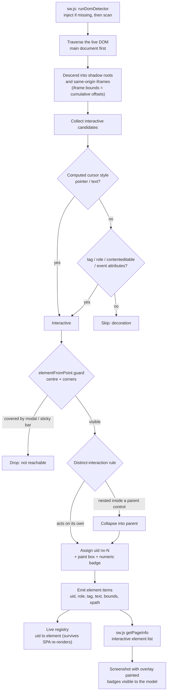
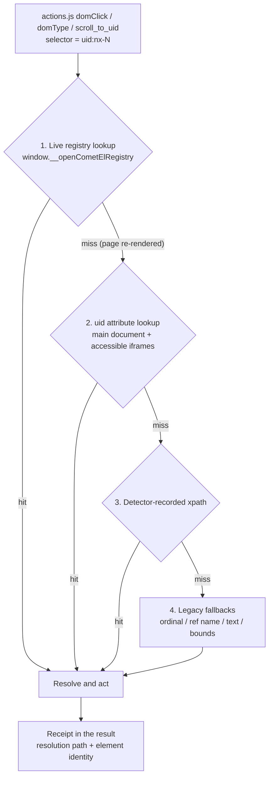

# DOM detector: element tagging and relocation

How the extension finds every interactive control on a page, labels it on
screen, and clicks the exact element the model chose.

## What it does

`src/content/dom-detector.js` walks the whole page and identifies interactive
elements the way a user sees them: anything that responds to a cursor, a tap or
keyboard focus. Each one is painted with a box and a numeric badge.

The number is the identity that ties three things together:

- The screenshot shows badge `15` next to a button.
- The interactive element list in the prompt contains the same control as
  `uid:nx-15`.
- The model answers `{"selector": "uid:nx-15"}`, and the executor relocates
  that element.

One identity per control across screenshot, prompt and click, with no
coordinate guessing.

## Detection pipeline

Three decisions carry most of the result:

- **Cursor first.** The computed `cursor` style is the strongest single signal,
  checked before tag, role, contenteditable and event-attribute heuristics.
  Custom widgets register even though they are not native controls: video
  player controls, mail chips, cards built as plain `
`s.
- **Top-element guard.** `elementFromPoint` at the centre and corners drops
  controls buried under modal backdrops, sticky headers and consent bars. ARIA
  menu containers stay exempt, because their options legitimately render over
  other content.
- **Distinct-interaction rule.** Nested interactives collapse into their parent
  unless they act on their own, so a composite widget gets one badge rather than
  a cluster.

## From badge to click

Pages re-render between the scan and the click. The detector gives the executor
four independent ways back to the same element:

The registry is the strongest link: a live `Map` of uid to element survives SPA
re-renders and reaches into shadow roots and iframes that `querySelector` cannot
cross. Xpath is the deterministic fallback. Text, ordinal and bounds matching
remain as the last resort, so nothing the old scan could click becomes
unclickable.

## What the model sees

Three views of the same page are fused into one prompt:

| View | Source | Carries |
|---|---|---|
| Screenshot | `chrome.tabs.captureVisibleTab`, with the badge overlay painted | Boxes and numeric badges |
| Element list | `dom-detector.js` items via `sw.js getPageInfo` | `uid:nx-N`, role, text, bounds, xpath |
| Page text | Inline scan, unchanged | Headings, tables, form labels |

The prompt states the mapping explicitly (`src/lib/prompts.js`): screenshot
badge `15` is selector `uid:nx-15`. The model is told to prefer `uid:`
selectors and fall back to `text:` or CSS only when the list has no match.

## Element fields

| Field | Meaning |
|---|---|
| `uid` | Stable id `nx-N`; the badge number is the uid without the prefix, also stamped as a DOM attribute |
| `role`, `tag` | Accessibility role or tag name |
| `text` | Visible label, truncated |
| `bounds` | Page-space rectangle; iframe items arrive pre-translated by cumulative offsets |
| `xpath` | Detector-recorded path, the deterministic relocation key |
| `editable`, `href` | Type hints that route items into the input and link groups |

Cross-origin frames are out of scope: they carry an error marker and are
skipped. Pixel-level privacy scanning still covers their contents.

## Where it hooks in

- `sw.js`: `runDomDetector()` (inject if missing, then scan), detector-first
  `getPageInfo` with the legacy inline scan as fallback, screenshot overlay
  coordination.
- `src/background/actions.js`: `domClick`, `domType` and `scroll_to_uid`
  relocation, plus disambiguation receipts.
- `src/content/dom-detector.js`: detection, painting, registry.
- `src/lib/prompts.js`: the badge-to-uid contract.
